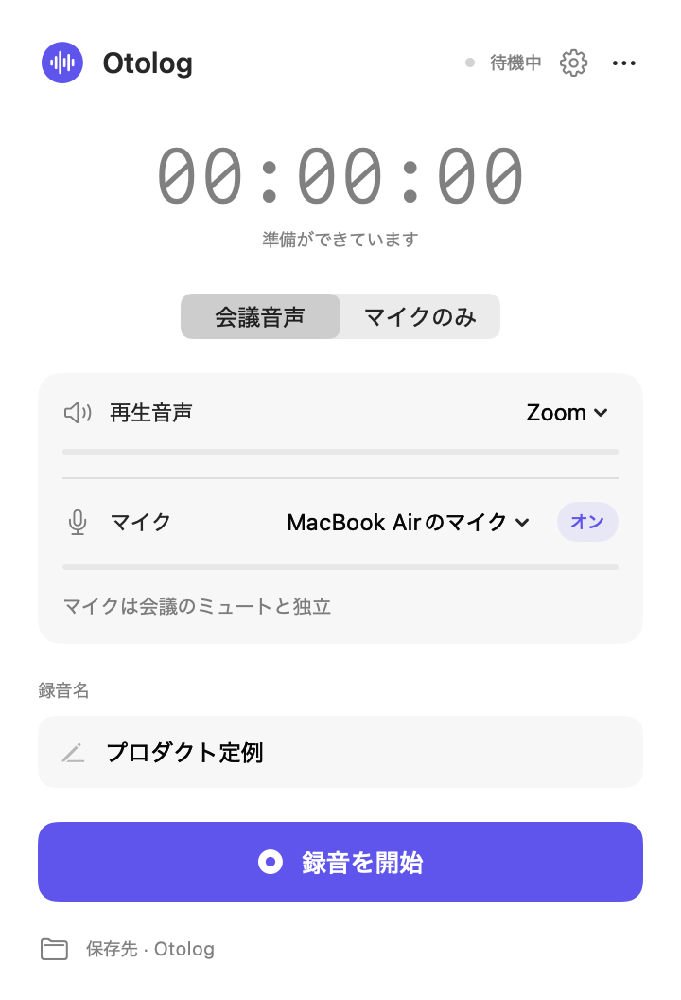
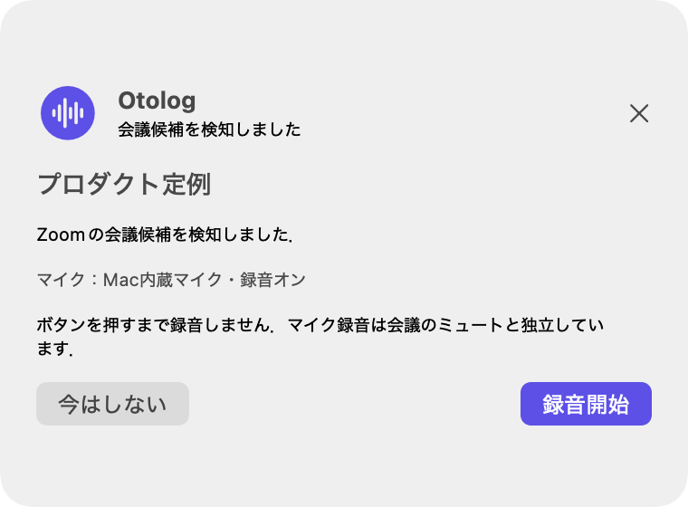

# Otolog

Macの会議音声とマイクを，ひとつの音声ファイルに．

Otologは，Swift／SwiftUIで作ったmacOS向けのメニューバー録音アプリです．Zoom，Microsoft Teams，ブラウザーのGoogle Meetなどの再生音声と，選択したマイクを混合してMac内へ保存します．マイクだけの録音にも対応しています．仮想オーディオドライバー，外部サーバー，クラウドサービスは不要です．

**開発中のアプリです．実会議での録音，AirPodsとの同時利用，長時間の実機安定性は未検証です．重要な録音の前に，短い試し録音を保存・再生して確認してください．**

<table>
  <tr><th>録音パネル</th><th>会議候補の通知</th></tr>
  <tr>
    <td></td>
    <td></td>
  </tr>
</table>

画像はサンプルデータを使ったUIの描画です．

## できること

- **会議音声＋マイク**：特定アプリ，またはMac全体の再生音声をデジタル取得し，選択したマイクと混合します．
- **マイクのみ**：Mac内蔵マイク，AirPods，USBマイクなどの入力を選んで録音します．
- **会議候補の通知**：Zoom／Teams／対応ブラウザーのマイク利用を手掛かりに，録音開始ボタン付きのポップアップを表示します．自動で録音は始めません．
- **会議名で保存**：取得できた会議名を既定の録音名にします．取得できない場合はJSTの開始日時を使います．開始前と保存後に名前を変更できます．
- **ローカル保存と回復**：M4A／AAC，48 kHz，ステレオ，192 kbpsを目標に保存します．録音中は分割した回復用データを残します．

## 必要な環境

| 項目 | 要件 |
| --- | --- |
| OS | macOS 15以降 |
| 開発環境 | Xcodeと初期設定の完了 |
| 確認済みの環境 | macOS 27.0.1，Xcode 27.1，macOS 27 SDK |
| ビルド対象 | Apple Silicon／IntelのUniversal Binary |
| 外部パッケージ | なし |

配布用の署名・公証済みバイナリーは用意していません．ソースからビルドして使用してください．

## ビルドと起動

```sh
git clone https://github.com/tetsugo02/Otolog.git
cd Otolog
./Scripts/build.sh
open build/Build/Products/Release/Otolog.app
```

または`Otolog.xcodeproj`をXcodeで開き，**Otolog**スキームと**My Mac**を選んでRunします．ビルドはローカル用のad-hoc署名です．

アプリはDockや通常のウインドウには表示されません．画面右上のメニューバーにある波形の丸いアイコンをクリックしてください．ビルドし直した場合は，実行中のOtologを終了してから開き直します．

## 使い方

1. **会議音声**または**マイクのみ**を選びます．会議モードでは，再生音声の対象アプリかMac全体を選びます．
2. マイクを選びます．会議モードでは，マイク行の「オン／オフ」で自分の声を含めるか設定できます．
3. 必要なら録音名を編集し，**録音を開始**を押します．空欄の場合はJSTの開始日時で保存します．
4. **停止して保存**を押し，保存処理の完了を待ちます．保存結果の矢印ボタンでFinderを開けます．鉛筆ボタンから名前を変更できます．

保存先の変更，通知の設定，会議名の取得，停止時の名前確認は，右上の歯車から開く設定画面にあります．初期保存先は`~/Music/Otolog`です．回復や終了は「…」メニューから操作します．

**Otologのマイク録音は，会議アプリのミュートと独立しています．** Zoomなどでミュートしても，Otologのマイクがオンなら自分の声を録音する場合があります．

## macOSの許可

| 許可 | 使用する機能 |
| --- | --- |
| マイク | 選択した入力マイクの録音 |
| システムオーディオ録音 | 会議アプリ・Mac全体の再生音声の録音 |
| アクセシビリティ（任意） | 対象アプリのウインドウタイトルから会議名を取得 |

システム設定 → プライバシーとセキュリティで確認できます．システム音声の項目は，OSによって「画面収録とシステムオーディオ録音」などの名前で表示されます．Otologは画面や映像を録画しません．マイクのみモードでは，システム音声の許可は不要です．

会議名を取得する場合は，Otologの設定で**ウインドウから会議名を取得**をオンにし，アクセシビリティを許可してください．許可後はアプリの再起動が必要な場合があります．

## 保存名と回復

会議名が取得できれば`プロダクト定例.m4a`，名前がなければ`2026-10-28_09-30-00_JST.m4a`のように保存します．同名ファイルには連番を付け，既存の音声を上書きしません．

録音中は，保存先の`.recording`フォルダーに30秒ごとのApple Lossless／CAFを保存します．停止後にAACへ一度だけ変換し，完成ファイル全体を再読み込みして，形式とフレーム数を確認してから回復用データを削除します．保存失敗時は元データを保持します．

異常終了後は「…」→「未完了の録音を回復」から保存を再試行できます．未確定の末尾約30秒と処理待ちの音声は失われる可能性があります．容量の目安は，完成ファイルと回復用データを合わせて**1時間あたり1.5 GB以上の空き**です．

## 制約と検証状況

- 会議検知は推定です．マイクテストなどを会議候補として通知する場合や，完全ミュートの会議を見逃す場合があります．
- 会議名は，アプリがウインドウタイトルに公開する情報から取得します．取得できない場合はJST日時を使います．Meetでは会議コードを名前に使う場合があります．
- ブラウザーの録音には他タブの音声が含まれる場合があります．タブ単位の取得には対応していません．
- AirPodsの入力・出力同時使用では，Bluetoothの通話モードによる音質制約があります．保存形式では改善しません．AirPods出力＋Mac内蔵／USBマイク入力も選べます．
- AirPods高音質モードとZoomの同時利用，切断・再接続，1時間の実録音，macOS 15／26での実行は未検証です．

録音と回復用音声はMac内に保存します．会議名の取得を有効にした場合は，抽出した名前をファイル名と回復用JSONに使います．Otolog自身が音声やタイトルを外部へ送信する処理はありません．

## 開発・検証

```sh
./Scripts/test.sh
```

ビルド後，合成音声による時刻同期，形式変換，混合，分割保存，AACの再読み込み，回復，会議候補の判定，会議名・JSTのファイル名を検証します．録音機器や会議サービスの実音声は使いません．テストで生成した音声とUI画像の場所は，実行結果の`Test artifacts:`に表示されます．

- [操作ガイドとトラブルシューティング](docs/USAGE.md)
- [音声処理・保存方式・手動テスト](docs/TECHNICAL.md)
- [実施済みの検証と未検証項目](Tests/VALIDATION.md)
